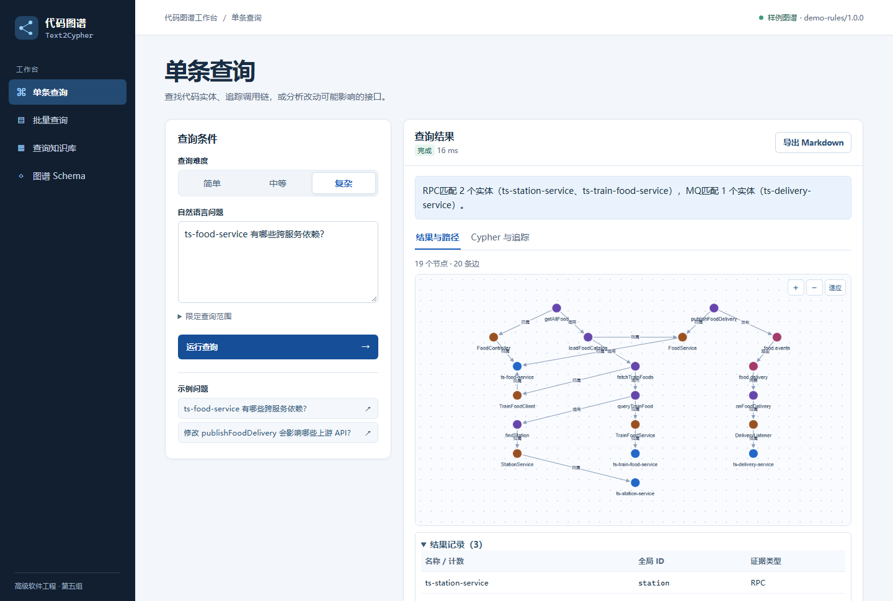
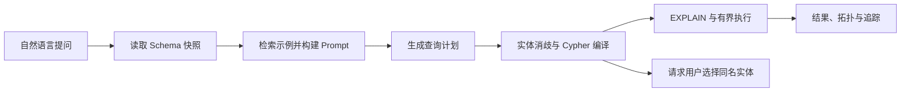

# Text2Cypher 代码图谱查询智能体 · YZJ

高级软件工程第五组课程项目。开发者输入自然语言问题，系统在图谱中定位实体，生成并校验参数化 Cypher，返回实体、调用路径、拓扑和可导出的查询记录。

界面使用 Vue 3 和 TypeScript。后端把结构化查询意图编译为参数化 Cypher，并在执行前校验 Schema。



## 快速运行

### Docker Compose

在仓库根目录执行，打开 `http://127.0.0.1:8000`。

```sh
docker compose up --build
```

### Windows 本机

环境要求为 Python 3.12 和 Node.js 22.12 或更新的 LTS 版本。在仓库根目录执行。

```powershell
python -m venv .venv
.\.venv\Scripts\python.exe -m pip install -r backend/requirements.txt
npm.cmd --prefix frontend ci
npm.cmd --prefix frontend run build
.\.venv\Scripts\python.exe -m uvicorn app.main:app --app-dir backend --host 127.0.0.1 --port 8000
```

开发前端时，另开一个终端执行 `npm.cmd --prefix frontend run dev`，访问 `http://localhost:5173`。开发服务器会将 `/api` 代理到本机 8000 端口。Linux 或 macOS 使用 `.venv/bin/python` 和 `npm`。

默认使用内置合成图谱和规则解析，启动时无需 Neo4j 账号或模型 Key。界面顶部显示正在使用的图谱和解析方式。后端 OpenAPI 文档位于 `/docs`。

## 演示流程

1. 选择简单查询，运行「列出所有微服务」。
2. 选择中等查询，运行「getAllFood 方法调用了哪些下游服务？」。从候选中选择 `ts-food-service` 的方法，检查同步调用的路径。
3. 选择复杂查询，运行「ts-food-service 有哪些跨服务依赖？」。同步 RPC 与异步 MQ 分别执行，按微服务 ID 合并，路径中保留发布、路由与消费阶段。
4. 切换「Cypher 与追踪」查看查询、绑定参数、阶段耗时和版本，使用「导出 Markdown」保存证据。
5. 批量入口支持 UTF-8 文本和 JSON 数组。文本每行一个问题，JSON 元素可以为字符串或请求对象。例如：

```json
[
  "列出所有微服务",
  {"question":"ts-food-service 有哪些跨服务依赖？","level":"complex"}
]
```

每批最多 50 题，批量任务共享 2 个执行槽位。单题失败会显示在对应行，已完成结果可单独查看，待确认实体可打开该题继续处理。知识库支持新增、修改、删除、类别和难度筛选、启用状态及版本历史。

## 工作原理



FastAPI 通过 Pydantic 校验查询意图。模型输出结构化计划，服务端用查询模式白名单编译 Cypher。节点标签、关系和属性均经过当前 Schema 核对，实体名和属性值通过参数绑定。Neo4j 模式使用预检、只读事务路由和独立只读凭据。图谱读取的两项元数据过程由后端固定调用。查询端口默认绑定本机，适用于课程演示和联调。

知识库以自然语言和结构化计划保存映射，按需生成当前 Schema 对应的 Cypher。TF-IDF 召回考虑中文词片、英文符号与同义表达，可打开模型语义重排，最终向生成阶段提供最多 3 个例子。总结由返回证据生成。复杂查询按通信机制拆分，方向由查询计划决定，调用段默认 6 跳，整条路径最多 10 跳。数据库查询事务预算为 5 秒，整题预算为 30 秒，模型计划修复最多 2 次。

默认每个子查询最多收录 1,000 行，超过时标记执行结果不完整。界面拓扑最多展示 100 个节点和 500 条边，Markdown 报告保留执行范围内的全部证据。SQLite 保存查询、批次、示例与版本。应用以单进程启动，批次任务在进程重启后标记为中断。

## 接入课程图谱

1. 复制 `.env.example` 为 `.env`。设置 `GRAPH_MODE=neo4j`、`NEO4J_URI`、`NEO4J_DATABASE`、`NEO4J_USER` 和 `NEO4J_PASSWORD`。请课程管理员配置独立只读账号，允许读取必要的 Schema 元数据。
2. 对照 `GET /api/schema` 核对节点标签、属性和关系。以 `backend/data/schema.demo.json` 为模板填写课程图谱的字段映射，并通过 `GRAPH_SCHEMA` 指向该文件。若实际归属及调用边方向、端点表示或 MQ 阶段与样例契约不同，需修改 `backend/app/compiler.py` 的相应路径模式并验证。详见 [图谱契约](docs/graph-contract.md)。
3. 设置 `LLM_PROVIDER` 为 `deepseek`、`glm` 或 `kimi`，填写对应的 `LLM_API_KEY` 和团队批准的 `LLM_MODEL`。配置 `LLM_SEMANTIC_RERANK=1` 可启用同一批准模型的语义重排。
4. Neo4j 模式默认从空知识库启动。可以在页面维护实库例子，也可以设置 `KB_SEED` 用准备好的 JSON 初始化一个新的 SQLite 文件。环境文件、数据库密码、模型 Key 与真实查询轨迹留在本地。

Compose 中的映射及样例文件路径使用容器路径。默认挂载宿主项目的 `backend/data` 到 `/app/backend/data`。用本机 Neo4j 时，可直接使用本机运行方式。

## 测试与评测

在已激活 Python 虚拟环境的终端，从 `backend` 目录运行以下命令。

```sh
python -m pytest -q
python -m evaluation.run --output ../artifacts/gold-demo-results.json
python -m evaluation.run --kb --output ../artifacts/kb-demo-results.json
python -m evaluation.run --no-examples --output ../artifacts/no-examples-demo-results.json
```

仓库包含 30 条样例知识库和独立的样例黄金 30 题，难度分布为简单 10、中等 12、复杂 8。评测保存每题的实际实体 ID 集合、机制、路径、Cypher、参数、总结、版本和耗时，另外汇总通过数与 P95。样例结果只用于验证项目实现。课程评分须以课程实库快照、批准模型、团队独立标注的黄金集和人工复核记录为准。完整交付核验步骤见 [验收与复现](docs/acceptance.md)。

## 目录

| 目录 | 内容 |
| --- | --- |
| `backend/app/` | FastAPI、图谱适配、检索、规划、编译、执行、报告 |
| `backend/data/` | 样例图谱、字段映射、KB30 |
| `backend/evaluation/` | 独立样例黄金集和评测工具 |
| `backend/skills/` | 版本化 Text2Cypher Prompt |
| `backend/tests/` | 查询管线、澄清、知识库和批量任务的回归测试 |
| `frontend/` | Vue 3、TypeScript 和 Cytoscape.js 界面 |
| `docs/` | 图谱契约、验收与复现 |
| `.github/workflows/text2cypher-course.yml` | 课程实现的 GitHub Actions 检查 |
